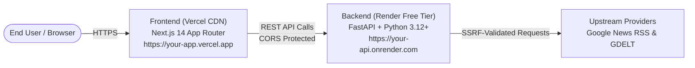

# Production Deployment Guide — Multilingual News Intelligence

This guide provides step-by-step instructions to deploy the **Multilingual News Intelligence** platform using standard, genuinely free-tier cloud infrastructure:
* **Frontend**: [Vercel](https://vercel.com/) (Next.js 14 App Router on Edge/Serverless CDN)
* **Backend**: [Render](https://render.com/) (FastAPI Python Web Service with automatic HTTPS)

---

## Architecture Overview



---

## 1. Prerequisites

1. A [GitHub](https://github.com/) account with the repository pushed to:
   `https://github.com/Hey-Ritik/multilingual-news-intelligence`
2. A free [Render](https://render.com/) account.
3. A free [Vercel](https://vercel.com/) account (linked to GitHub).

---

## 2. Step 1: Deploy the Backend on Render

Deploy the backend first so you have its production HTTPS URL ready for the frontend.

1. Log in to the [Render Dashboard](https://dashboard.render.com/).
2. Click **New +** $\rightarrow$ **Web Service**.
3. Connect your GitHub repository: `Hey-Ritik/multilingual-news-intelligence`.
4. Configure the service settings:
   * **Name**: `multilingual-news-intelligence-api` (or preferred name)
   * **Region**: Choose the closest region (e.g., `Singapore` or `Frankfurt`)
   * **Branch**: `main`
   * **Root Directory**: `backend`
   * **Runtime**: `Python 3`
   * **Build Command**: `pip install -r requirements.txt`
   * **Start Command**: `uvicorn app.main:app --host 0.0.0.0 --port $PORT`
   * **Instance Type**: `Free` (512 MB RAM, 0.1 CPU)
5. Under **Advanced** $\rightarrow$ **Environment Variables**, add:
   | Key | Value | Description |
   | :--- | :--- | :--- |
   | `APP_ENV` | `production` | Production environment flag |
   | `DEBUG` | `false` | Disables debug mode and enforces CORS whitelist |
   | `CORS_ORIGINS` | `http://localhost:3000` | Will be updated with your Vercel URL in Step 3 |
   | `SUPPORTED_LANGUAGES` | `en,hi,kn,te,ta` | Target cross-language analysis codes |
   | `REQUEST_TIMEOUT_SECONDS` | `10` | Outbound request timeout guardrail |
   | `MAX_TEXT_LENGTH_CHARS` | `100000` | Ingestion character limit |
6. Set the **Health Check Path** to:
   `/api/health`
7. Click **Create Web Service**.
8. Wait for the build to finish. Once live, copy your backend URL:
   `https://<your-backend-name>.onrender.com`
9. Test the health endpoint in your browser:
   `https://<your-backend-name>.onrender.com/api/health`
   Should return: `{"status":"ok","supported_languages":["en","hi","kn","te","ta"],...}`

---

## 3. Step 2: Deploy the Frontend on Vercel

1. Log in to the [Vercel Dashboard](https://vercel.com/dashboard).
2. Click **Add New...** $\rightarrow$ **Project**.
3. Select and import the `multilingual-news-intelligence` repository.
4. In the configuration screen:
   * **Project Name**: `multilingual-news-intelligence`
   * **Framework Preset**: `Next.js`
   * **Root Directory**: Click **Edit** and select `frontend`
   * **Build Command**: `next build` (default)
   * **Output Directory**: `.next` (default)
5. Expand **Environment Variables** and add:
   | Key | Value | Description |
   | :--- | :--- | :--- |
   | `NEXT_PUBLIC_API_URL` | `https://<your-backend-name>.onrender.com` | Production URL of your Render backend |
6. Click **Deploy**.
7. Vercel will build and deploy the Next.js application in under 2 minutes.
8. Once complete, copy your production frontend URL (e.g., `https://multilingual-news-intelligence.vercel.app`).

---

## 4. Step 3: Connect Production CORS

To ensure the browser allows secure cross-origin API calls between your Vercel domain and your Render backend:

1. Return to your Render dashboard $\rightarrow$ `multilingual-news-intelligence-api` $\rightarrow$ **Environment**.
2. Update the `CORS_ORIGINS` variable:
   ```text
   https://<your-app-name>.vercel.app,http://localhost:3000
   ```
3. Render will automatically redeploy the service with the updated CORS policy in under 30 seconds.

---

## 5. Free-Tier Characteristics & Best Practices

1. **Render Cold Starts**: On the free tier, Render automatically spins down services that receive no traffic for 15 minutes. The first request after inactivity may take 30–50 seconds to initialize. Subsequent requests respond in milliseconds.
2. **Deterministic NLP on CPU**: The application's core language detection, sentiment negation, quotation de-nesting, and Indic entity normalizer are specifically optimized for standard CPU execution without requiring costly GPU instances.
3. **SSRF Guardrails**: The backend strictly validates outbound article URL targets to prevent Server-Side Request Forgery against internal cloud metadata endpoints (`169.254.169.254`) and loopback addresses.

---

## 6. Troubleshooting

| Symptom | Cause | Solution |
| :--- | :--- | :--- |
| **CORS Error in Browser Console** | `CORS_ORIGINS` on Render does not include your exact Vercel domain. | Add `https://<your-app>.vercel.app` (without trailing slash) to `CORS_ORIGINS` in Render settings. |
| **Network Error / Failed to Fetch** | Backend is asleep (Render cold start) or `NEXT_PUBLIC_API_URL` is misconfigured. | Open `https://<your-backend>.onrender.com/api/health` directly in browser to wake the service. Verify Vercel environment variable. |
| **PDF Download 500 Error** | Missing font assets or character set mismatch. | ReportLab is configured to fall back to `Helvetica` when Unicode fonts (`Nirmala.ttc`) are unavailable on Linux environments. |
| **Article URL Fetch Blocked** | Target website employs Cloudflare bot-management or paywalls. | The system gracefully falls back to RSS/GDELT snippet evidence. |

