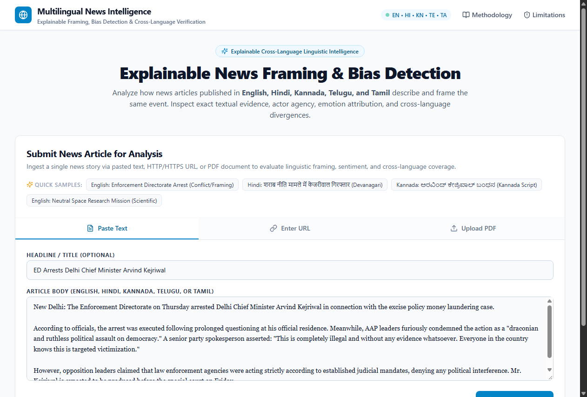
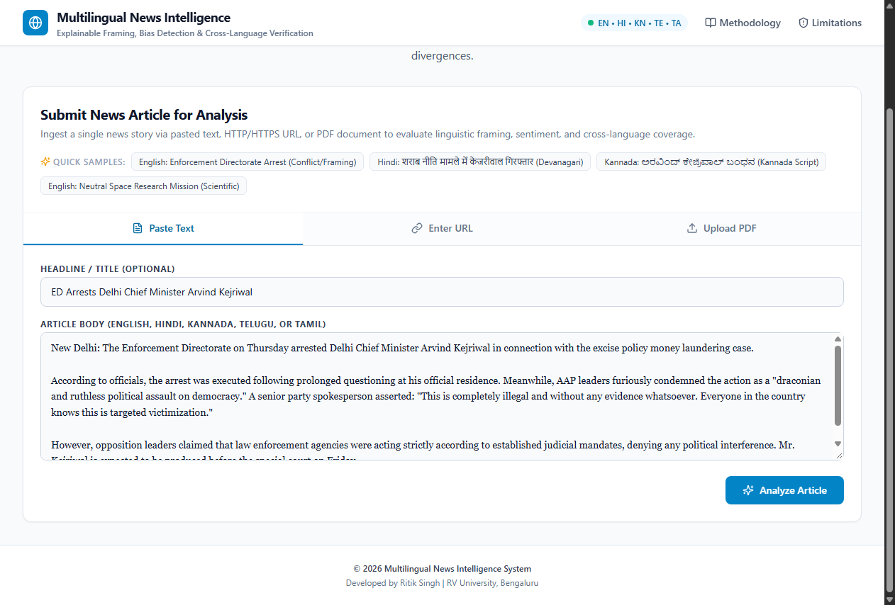
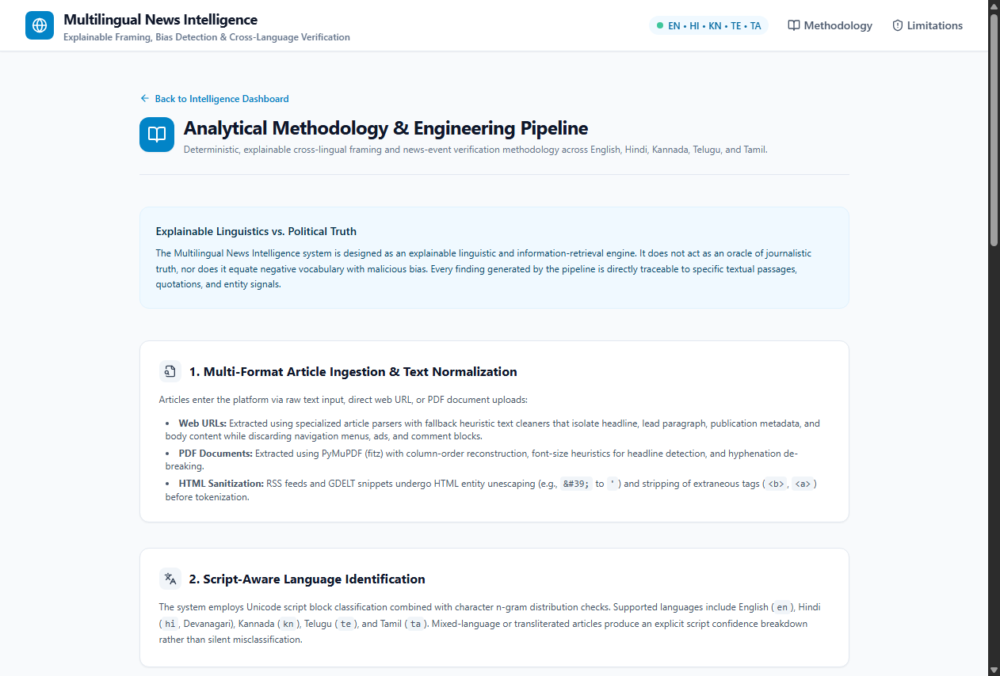
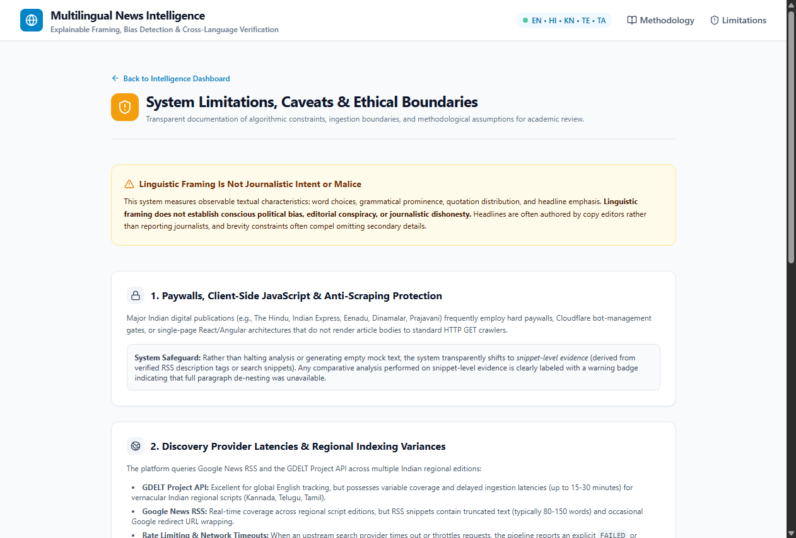
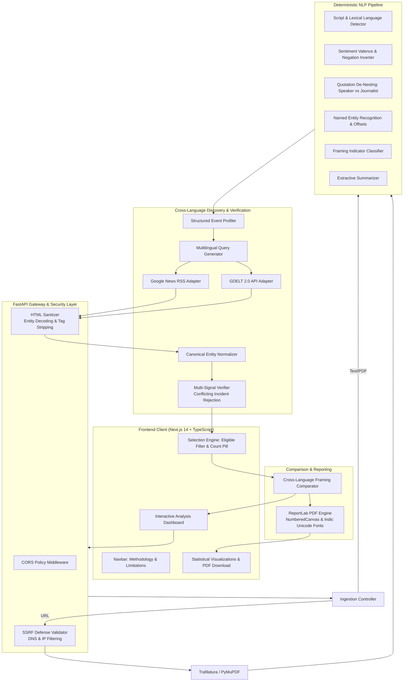

# Multilingual News Intelligence: Explainable Framing, Bias Detection & Cross-Language Verification

[](https://www.python.org/)
[](https://fastapi.tiangolo.com/)
[](https://nextjs.org/)
[](https://www.typescriptlang.org/)
[](docs/TESTING.md)
[](#22-license--academic-attribution)

An explainable natural language processing and cross-language information retrieval system designed to analyze how news events are framed, described, and contextualized across **English, Hindi, Kannada, Telugu, and Tamil**.

Developed by **Ritik Singh** at **RV University, Bengaluru**.

Target Repository: [https://github.com/Hey-Ritik/multilingual-news-intelligence](https://github.com/Hey-Ritik/multilingual-news-intelligence)

---

## Table of Contents

- [1. Project Overview & Motivation](#1-project-overview--motivation)
- [2. Problem Statement](#2-problem-statement)
- [3. Project Objectives](#3-project-objectives)
- [4. Key Verified Features](#4-key-verified-features)
- [5. Application Visual Tour & Screenshots](#5-application-visual-tour--screenshots)
- [6. System Architecture](#6-system-architecture)
- [7. Actual Technology Stack](#7-actual-technology-stack)
- [8. Actual NLP Pipeline & Methodology](#8-actual-nlp-pipeline--methodology)
- [9. Data Sources & Retrieval Strategy](#9-data-sources--retrieval-strategy)
- [10. Installation Prerequisites](#10-installation-prerequisites)
- [11. Windows PowerShell Setup Instructions](#11-windows-powershell-setup-instructions)
- [12. Environment Variable Configuration](#12-environment-variable-configuration)
- [13. Running the Backend](#13-running-the-backend)
- [14. Running the Frontend](#14-running-the-frontend)
- [15. API Documentation](#15-api-documentation)
- [16. Testing Instructions & Status](#16-testing-instructions--status)
- [17. Production Deployment Architecture](#17-production-deployment-architecture)
- [18. Known Limitations](#18-known-limitations)
- [19. Responsible Use & Ethics](#19-responsible-use--ethics)
- [20. Future Roadmap](#20-future-roadmap)
- [21. Team & Acknowledgements](#21-team--acknowledgements)
- [22. License](#22-license)

---

## 1. Project Overview & Motivation

When a major geopolitical, legal, or social event occurs, news publishers across linguistic spheres describe and frame the story differently. Differences emerge in headline prominence, actor agency, emotional register, and selective omissions. 

Existing automated "bias detection" tools typically suffer from two severe flaws:
1. **The Oracle Fallacy**: Outputting arbitrary, uninterpretable percentages (e.g. *"87% Biased"*) that claim to determine journalistic intent or objective truth.
2. **The Sentiment-as-Bias Fallacy**: Treating negative reporting on crime, corruption, or policy disputes as ideological bias, conflating rigorous investigative reporting with editorial hostility.

**Multilingual News Intelligence** addresses these challenges by prioritizing **explainability, quote de-nesting, and multi-signal event verification**. Instead of declaring an article "biased", it pinpoints exact textual passages where framing occurs, analyzes comparative coverage of the same event across Indian languages, and generates downloadable academic reports.

---

## 2. Problem Statement

How do news publications in different languages frame the same event, what specific textual evidence supports those differences, and how can automated retrieval verify that two articles in different scripts describe the *same real-world event* rather than unrelated incidents sharing a location or generic verb?

---

## 3. Project Objectives

1. **Multi-Modal Ingestion**: Support raw text, direct HTTP/HTTPS web URLs with SSRF protection, and digital PDF documents.
2. **Script-Aware Language Identification**: Reliably distinguish English (`en`), Hindi (`hi`), Kannada (`kn`), Telugu (`te`), and Tamil (`ta`).
3. **Quotation De-Nesting**: Decouple quoted source statements from journalist narration so emotional statements uttered by speakers are never falsely attributed to the reporter.
4. **Strict Offset Grounding**: Guarantee that every framing finding corresponds to exact zero-based Unicode code-point offsets `[start:end]` without shifting on Indic scripts.
5. **Cross-Language Discovery**: Automatically generate targeted search queries across Google News RSS and GDELT 2.0.
6. **False-Positive-Resistant Event Matching**: Disambiguate *same event* coverage from *unrelated events involving the same person or location* using multi-attribute verification.
7. **Side-by-Side Framing Comparison**: Enable users to select discovered coverage and compare headline wording, lead angles, attribution ratios, and omissions.
8. **Exportable Intelligence**: Compile quantitative charts, indicator density metrics, and downloadable A4 ReportLab PDF reports.

---

## 4. Key Verified Features

* **Multi-Modal Ingestion**:
  * Text area with automatic character bounds ($\le 100,000$ chars).
  * Direct URL scraping with strict SSRF defense (blocking loopback, RFC1918 private subnets, and cloud metadata `169.254.169.254`).
  * PDF parser using PyMuPDF (`fitz`) with automatic scanned-document detection.
* **Explainable Framing Viewer**:
  * Color-coded character-offset highlights across 9 linguistic dimensions: Loaded Language, Actor Portrayal, Allegations, Fact vs Opinion, Generalizations, Hedging, Prominence, Viewpoint Balance, and Selective Presentation.
* **Speaker Emotion vs. Journalist Narration**:
  * Quotation boundary de-nesting ensures quoted emotional assertions (e.g., *"This is a draconian attack"*) are tagged to the quoted speaker rather than the outlet.
* **Cross-Language Event Verification**:
  * Multi-signal verification classifying candidates into `VERIFIED SAME EVENT`, `POSSIBLE MATCH`, `RELATED TOPIC ONLY`, and `DIFFERENT EVENT`.
  * Conflicting incident guardrails reject street violence, narcotics busts, and cyber fraud from political event matches.
  * Canonical entity normalizer supports cross-script aliases across Latin, Devanagari, Kannada, Telugu, and Tamil.
* **Interactive Article Selection & Comparison**:
  * Selection checkboxes, live selection count pill, **Select All Eligible**, and **Clear Selection** controls.
  * Side-by-side passage comparison across headline emphasis, lead sentence focus, attribution balance, and omissions.
  * Snippet-level evidence fallback with explicit disclosure badges when full text scraping is prevented by paywalls.
* **Quantitative Reporting & PDF Export**:
  * Indicator density per 1,000 tokens, category distributions (Recharts), and publication metadata.
  * Instant generation of downloadable A4 paginated PDFs using ReportLab with `NumberedCanvas` headers and Indic font rendering.

---

## 5. Application Visual Tour & Screenshots

All screenshots are captured directly from the live, running application with real data:

| View | Screenshot |
| :--- | :--- |
| **01. Article Overview**<br/>Metadata metrics, language script badge, and extractive summary. |  |
| **02. Multilingual NLP Pipeline**<br/>Sentiment valence, quotation de-nesting, NER offsets, and claims. |  |
| **03. Explainable Framing Viewer**<br/>Character-offset highlight viewer with textual evidence spans. |  |
| **04. Cross-Language Discovery**<br/>Multilingual query generation, candidate cards, and selection controls. |  |
| **05. Event Verification Guardrails**<br/>Multi-signal status badges (`VERIFIED SAME EVENT`, `RELATED TOPIC ONLY`, `DIFFERENT EVENT`). |  |
| **06. Side-by-Side Framing Comparison**<br/>Cross-language comparative dimensions and snippet provenance badges. |  |
| **07. Statistical Report & PDF Export**<br/>Quantitative charts, density metrics, and downloadable A4 ReportLab PDF. |  |
| **08. Analytical Methodology**<br/>Dedicated route (`/methodology`) documenting the 6-stage NLP pipeline. |  |
| **09. System Limitations & Boundaries**<br/>Dedicated route (`/limitations`) documenting paywalls and ethical constraints. |  |

---

## 6. System Architecture



For full architectural details, see [docs/ARCHITECTURE.md](docs/ARCHITECTURE.md).

---

## 7. Actual Technology Stack

### Backend
* **Python 3.12 / 3.13**
* **FastAPI**: Asynchronous REST API framework with Pydantic v2 schemas.
* **PyMuPDF (`fitz`)**: Selectable text extraction and scanned document detection.
* **BeautifulSoup4 & Feedparser**: HTML entity unescaping, markup stripping, and RSS feed ingestion.
* **ReportLab**: High-fidelity A4 paginated PDF generation with `NumberedCanvas` running headers and Indic font support.
* **Langdetect**: Script and character n-gram language detection.
* **Pytest & Pytest-Asyncio**: 32 automated unit and integration tests.

### Frontend
* **Next.js 14 (App Router)**: React 18 framework with TypeScript.
* **Tailwind CSS**: Clean typography and academic research design system.
* **Recharts**: Data visualizations for sentiment composition and indicator densities.
* **Lucide React**: Modern iconography.

---

## 8. Actual NLP Pipeline & Methodology

1. **Text Normalization**: Decodes HTML entities (`&amp;`, `&#39;`) and strips markup tags (`<b>`, `<a>`, `<font>`).
2. **Language Detection**: Evaluates Unicode script ranges (Devanagari, Kannada, Telugu, Tamil, Latin) and applies functional word markers to separate Hindi from Marathi.
3. **Sentiment & Negation Inversion**: Evaluates valence with clause-level negation shifters (*not, never, nahīn, illa, kaadu, illai*).
4. **Quotation De-Nesting**:
   $$\text{Emotional Statement} \in \text{Quotation} \implies \text{SPEAKER\_EMOTION}$$
   $$\text{Emotional Statement} \notin \text{Quotation} \implies \text{JOURNALIST\_NARRATION}$$
5. **Named Entity Recognition**: Extracts entities with exact Unicode offsets `Text[S:E] == Entity`, incorporating Indic honorifics (*Shri, Mukhyamantri, Pradhani, Thiru*).
6. **Framing Detection**: Identifies loaded language, cognitive hedging, generalizations, and actor portrayals with normalized density per 1,000 tokens.
7. **Conservative Event Matching**:
   * Conflicting incidents (chole stabbing, heroin, cyber fraud) are rejected as `DIFFERENT EVENT`.
   * Primary actors matched via transliteration aliases (*Arvind Kejriwal* $\leftrightarrow$ *अरविंद केजरीवाल* $\leftrightarrow$ *ಅರವಿಂದ ಕೇಜ್ರಿವಾಲ್*).
   * Verified candidates require matching actors, action compatibility, and case context.

For mathematical formalisms, see [docs/METHODOLOGY.md](docs/METHODOLOGY.md).

---

## 9. Data Sources & Retrieval Strategy

* **Upstream Providers**:
  * **Google News RSS**: Real-time regional feeds with language parameters (`ceid=IN:hi`, `ceid=IN:kn`, `ceid=IN:te`, `ceid=IN:ta`).
  * **GDELT 2.0 Doc API**: Global multi-language event tracking with `sourcelang` filters.
* **Resilience**: Executed concurrently via `asyncio.gather(..., return_exceptions=True)`. Provider timeouts report degraded status rather than fabricating zero results.
* **Snippet-Level Evidence**: When external news sites employ paywalls or bot blockers, the system falls back to verified RSS/GDELT snippet evidence with clear disclosure badges.

---

## 10. Installation Prerequisites

* **Operating System**: Windows 10/11, macOS, or Linux.
* **Python**: Version 3.12 or 3.13 installed and available on PATH.
* **Node.js**: Version 18.x, 20.x, or 22.x with `npm`.
* **Git**: Installed for version control.

---

## 11. Windows PowerShell Setup Instructions

Clone the repository and set up backend and frontend environments:

```powershell
# 1. Clone the repository
git clone https://github.com/Hey-Ritik/multilingual-news-intelligence.git
cd multilingual-news-intelligence

# 2. Set up Python Virtual Environment (Backend)
cd backend
python -m venv venv
.\venv\Scripts\Activate.ps1

# 3. Install Backend Dependencies
pip install -r requirements.txt
cd ..

# 4. Install Frontend Dependencies
cd frontend
npm install
cd ..
```

---

## 12. Environment Variable Configuration

Copy the example environment file:

```powershell
# Copy .env.example to backend/.env
Copy-Item .env.example backend\.env
```

Default configuration in `.env.example`:
```ini
APP_NAME="Multilingual News Intelligence"
APP_ENV=development
DEBUG=true
HOST=0.0.0.0
PORT=8000
CORS_ORIGINS=http://localhost:3000,http://127.0.0.1:3000
SUPPORTED_LANGUAGES=en,hi,kn,te,ta
REQUEST_TIMEOUT_SECONDS=10
NEXT_PUBLIC_API_URL=http://localhost:8000
```

---

## 13. Running the Backend

From the repository root in PowerShell:

```powershell
cd backend
.\venv\Scripts\Activate.ps1
$env:PYTHONPATH="."
python -m uvicorn app.main:app --host 0.0.0.0 --port 8000 --reload
```

The FastAPI backend will be live at: `http://localhost:8000`

---

## 14. Running the Frontend

From a second PowerShell terminal:

```powershell
cd frontend
npm run dev
```

Open `http://localhost:3000` in your browser.

To verify a production build:
```powershell
npm run build
npm start
```

---

## 15. API Documentation

Interactive OpenAPI documentation is generated automatically by FastAPI:
* **Swagger UI**: [http://localhost:8000/docs](http://localhost:8000/docs)
* **ReDoc**: [http://localhost:8000/redoc](http://localhost:8000/redoc)
* **Health Check**: `GET http://localhost:8000/api/health`

---

## 16. Testing Instructions & Status

The automated test suite consists of **32 deterministic tests** covering event matching, false positive rejection, ingestion, SSRF protection, NLP pipelines, and PDF generation.

```powershell
# Run the complete test suite from repository root
$env:PYTHONPATH="backend;backend/tests"
python -m pytest backend/tests -v
```

### Verified Test Results:
```text
backend/tests/unit/test_cross_discovery_matching.py::test_event_profiler_and_query_generation PASSED
backend/tests/unit/test_cross_discovery_matching.py::test_false_positive_rejection_chole_stabbing PASSED (DIFFERENT EVENT)
backend/tests/unit/test_cross_discovery_matching.py::test_false_positive_rejection_cyber_fraud PASSED (DIFFERENT EVENT)
backend/tests/unit/test_cross_discovery_matching.py::test_false_positive_rejection_heroin_narcotics PASSED (DIFFERENT EVENT)
backend/tests/unit/test_cross_discovery_matching.py::test_true_positive_hindi_kejriwal_arrest PASSED (VERIFIED SAME EVENT)
backend/tests/unit/test_cross_discovery_matching.py::test_true_positive_vernacular_languages PASSED (KN, TE, TA verified)
backend/tests/unit/test_cross_discovery_matching.py::test_same_actor_different_event_is_related_topic PASSED (RELATED TOPIC)
backend/tests/unit/test_cross_discovery_matching.py::test_html_sanitizer_unescapes_entities_and_removes_tags PASSED
backend/tests/unit/test_cross_discovery_matching.py::test_cross_language_framing_comparison PASSED
backend/tests/unit/test_framing_analysis.py (3 tests) PASSED
backend/tests/unit/test_ingestion.py (7 tests) PASSED
backend/tests/unit/test_nlp_pipeline.py (7 tests) PASSED
backend/tests/unit/test_pdf_report.py (1 test) PASSED
backend/tests/integration/test_api_endpoints.py (5 tests) PASSED
============================== 32 passed in 6.26s ==============================
```

For complete test specifications, see [docs/TESTING.md](docs/TESTING.md).

---

## 17. Production Deployment Architecture

The application is structured for free-tier cloud deployment:
* **Frontend**: [Vercel](https://vercel.com/) (Next.js 14 App Router, Serverless Edge CDN)
* **Backend**: [Render](https://render.com/) (FastAPI Python Web Service, Free Tier 512MB RAM)

### Configuration Highlights:
* **Render Start Command**: `uvicorn app.main:app --host 0.0.0.0 --port $PORT`
* **Render Environment**: `APP_ENV=production`, `DEBUG=false`, `CORS_ORIGINS=https://<your-app>.vercel.app`
* **Vercel Environment**: `NEXT_PUBLIC_API_URL=https://<your-backend>.onrender.com`

For complete step-by-step instructions, see [DEPLOYMENT.md](DEPLOYMENT.md).

---

## 18. Known Limitations

1. **Linguistic Framing $\neq$ Malicious Bias**: Observable textual choices do not establish conscious bias or journalistic malice. Headlines are often written by copy editors, and brevity constraints necessitate omitting secondary details.
2. **Paywalls & Client-Side Rendering**: Indian news outlets frequently use paywalls or dynamic single-page applications. The system gracefully falls back to snippet-level evidence.
3. **Indic Transliteration Variants**: Unrecognized spelling variants of minor public actors may fall into lower confidence thresholds.
4. **Search Provider Latency**: Upstream GDELT API and Google News RSS indexing latencies range from 5 to 30 minutes for regional Indian languages.

---

## 19. Responsible Use & Ethics

* This system is designed as an **analytical intelligence instrument** for media researchers, journalism students, and computational linguists.
* It must not be used to automate censorship, harass journalists, or make definitive legal determinations of misinformation.

---

## 20. Future Roadmap

- [ ] Extension to Marathi (`mr`), Bengali (`bn`), and Malayalam (`ml`).
- [ ] Integration of open-weight multilingual LLM verification (e.g. IndicBERT-v2 / Sarvam).
- [ ] Longitudinal temporal tracking of news event coverage across 7-day lifecycles.
- [ ] Export formats for academic citation management (BibTeX, CSV, JSON-LD).

---

## 21. Team & Acknowledgements

* **Developer & Researcher**: **Ritik Singh**
* **Institution**: **RV University, Bengaluru**
* **Course Context**: Academic Research & Final Year Project Evaluation

Special thanks to the open-source communities behind FastAPI, Next.js, PyMuPDF, ReportLab, and Lucide Icons.

---

## 22. License & Academic Attribution

This research project was developed by **Ritik Singh** at **RV University, Bengaluru**. Standard MIT License terms apply upon repository publication. Contribution and educational usage guidelines are documented in [docs/METHODOLOGY.md](docs/METHODOLOGY.md).
