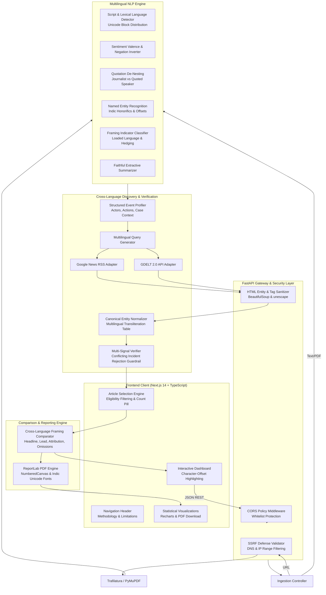

# System Architecture Specification — Multilingual News Intelligence

## 1. Executive Architecture Summary

**Multilingual News Intelligence** is a multi-tier natural language processing and information retrieval system that analyzes news coverage of the same event across five major Indian languages:
* **English (`en`)**
* **Hindi (`hi`)** — Devanagari script
* **Kannada (`kn`)** — Kannada script
* **Telugu (`te`)** — Telugu script
* **Tamil (`ta`)** — Tamil script

The system is built on six decoupled engineering layers:
1. **Multi-Modal Ingestion & SSRF Protection** (Text, URL, PyMuPDF).
2. **Deterministic Multilingual NLP Pipeline** (Language detection, sentiment inversion, quotation de-nesting, NER offsets, claims).
3. **Structured Event Profiler & Cross-Language Discovery** (Translating actors, actions, and locations into Google News RSS and GDELT 2.0 queries).
4. **Multi-Signal Event Verifier** (Rejection of conflicting incidents, transliteration canonicalization, and strict conservative classification).
5. **Interactive Cross-Language Framing Comparator** (Side-by-side headline, lead, attribution, and omission analysis with snippet provenance badges).
6. **Academic Presentation & Reporting** (Next.js 14 App Router, Recharts, and ReportLab A4 paginated PDF generation).

---

## 2. End-to-End System Architecture

---

## 3. Detailed Component Architecture

### 3.1 Ingestion & Network Guardrails (`backend/app/services/ingestion/`)
* **`text_ingest.py`**: Validates character boundaries ($\le 100,000$ chars), computes sentence and token metrics, and preserves uncorrupted Unicode code points.
* **`url_ingest.py` & `ssrf_protector.py`**: Strict SSRF defense. Resolves target hostnames against DNS, blocking:
  * Loopback (`127.0.0.0/8`, `::1`)
  * RFC1918 Private networks (`10.0.0.0/8`, `172.16.0.0/12`, `192.168.0.0/16`)
  * Unique Local IPv6 (`fc00::/7`)
  * Cloud Link-Local Metadata endpoints (`169.254.169.254`)
  * Non-HTTP schemes (`ftp://`, `file:///`, `gopher://`)
* **`pdf_ingest.py`**: Uses PyMuPDF (`fitz`). Implements scanned document heuristics: if a PDF page has images but $< 40$ characters of selectable text, it explicitly notifies the user that OCR would be required, preventing empty or corrupt text pipelines.

### 3.2 Multilingual NLP Pipeline (`backend/app/services/`)
* **`language/detector.py`**: Script-aware Unicode block classifier distinguishing Devanagari (Hindi), Kannada, Telugu, Tamil, and Latin (English) with functional word markers to disambiguate Hindi from Marathi.
* **`sentiment/sentiment_analyzer.py`**: Multilingual polarity lexicon with sentence-level negation inverters (*not, never, nahīn, illa, kaadu, illai*). Strictly distinguishes investigative reporting from personal journalist bias.
* **`emotion/emotion_analyzer.py`**: Implements **Quotation Attribution De-Nesting**. Splits text into reported quotes and editorial narration. Emotional assertions uttered by interviewed sources are classified as `SPEAKER_EMOTION` and never attributed to the journalist.
* **`entities/entity_extractor.py`**: Locates Person, Organization, and Location entities. Accommodates Indic honorifics (*Shri, Mukhyamantri, Pradhani, Thiru*) and maintains exact zero-based Unicode code-point offsets `[start:end]`.
* **`framing/framing_analyzer.py`**: Analyzes loaded words, evaluative terms, cognitive hedging, generalizations, and agency attribution. Every finding satisfies $\text{Text}[S:E] == \text{ExactText}$.

### 3.3 Event Profiling & Multilingual Discovery (`backend/app/services/news_discovery/`)
* **`event_profiler.py`**: Synthesizes structured event representations: primary actors, organizations, main action verbs, locations, and incident context identifiers (e.g., excise policy, solar initiative).
* **`query_generator.py`**: Generates targeted, complementary search queries for English, Hindi, Kannada, Telugu, and Tamil using translated action stems and transliterated proper nouns.
* **`google_news_rss.py` & `gdelt_adapter.py`**: Search Google News RSS feeds with language-specific parameters (`ceid=IN:hi`, `ceid=IN:kn`, etc.) and GDELT 2.0 Doc API with `sourcelang` filters. Sanitizes upstream HTML entities and tags before processing.

### 3.4 Multi-Signal Event Matching (`backend/app/services/event_matching/`)
* **`entity_normalizer.py`**: Maintains canonical multilingual alias mappings (e.g. *Arvind Kejriwal* $\leftrightarrow$ *अरविंद केजरीवाल* $\leftrightarrow$ *ಅರವಿಂದ ಕೇಜ್ರಿವಾಲ್* $\leftrightarrow$ *అరవింద్ కేజ్రీవాల్* $\leftrightarrow$ *அரவிந்த் கெஜ்ரிவால்*) and incident context taxonomy.
* **`verifier.py`**: Conservative multi-signal verification:
  1. **Conflicting Incident Guardrail**: Immediately marks street violence (chole stabbing), narcotics (heroin), or cyber-fraud as `DIFFERENT EVENT`.
  2. **Primary Actor Alignment**: Requires transliterated match of main actors.
  3. **Action Concordance**: Multi-lingual action stems (*arrested $\leftrightarrow$ गिरफ्तार $\leftrightarrow$ ಬಂಧಿಸಿದೆ $\leftrightarrow$ అరెస్ట్ $\leftrightarrow$ கைது*).
  4. **Case Corroboration**: Overlap in incident/case taxonomy markers.
  5. **Conservative Decision**: Classifies into `VERIFIED SAME EVENT`, `POSSIBLE MATCH`, `RELATED TOPIC ONLY`, `DIFFERENT EVENT`.

### 3.5 Cross-Language Comparator (`backend/app/services/comparison/`)
* **`cross_comparator.py`**: Computes side-by-side comparative matrices between the source article and user-selected candidates across headline framing, lead focus, actor portrayal, and narrative omissions.
* **Snippet-Level Fallback**: When paywalls prevent scraping full article bodies, gracefully shifts to snippet-level evidence with explicit user badges.

### 3.6 PDF Report Generator (`backend/app/services/reporting/`)
* **`pdf_generator.py`**: Built using ReportLab. Generates A4 paginated academic reports with `NumberedCanvas` running headers, statistical summary tables, and native Indic Unicode font rendering (`Nirmala.ttc` / `Arial`).
