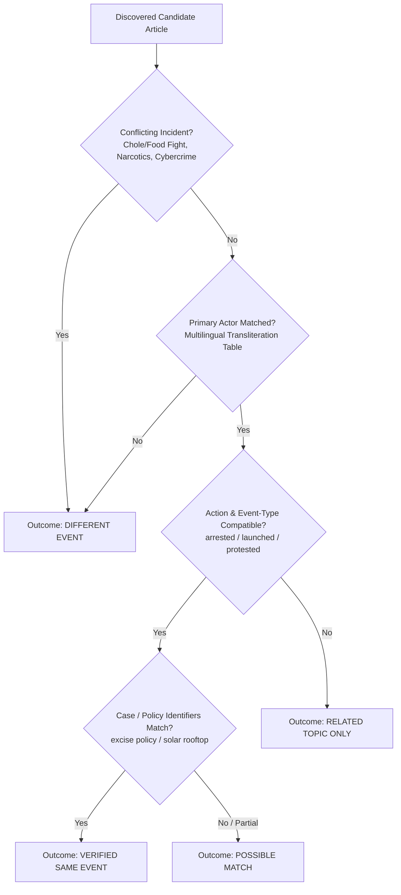

# Linguistic Framing & Cross-Language Verification Methodology

## 1. Foundational Analytical Philosophy

The **Multilingual News Intelligence** platform approaches media analysis from an explainable linguistic and information-retrieval perspective. It explicitly rejects two widespread fallacies in automated media analysis:

1. **The Oracle Fallacy**: Assigning an arbitrary numerical score (e.g. "82% Biased") that purports to divine journalistic intent or political truth.
2. **The Sentiment-as-Bias Fallacy**: Equating negative sentiment with bias. Investigative reporting on corruption, accidents, conflict, or governance failures is inherently negative in tone yet constitutes high-integrity public interest journalism.

---

## 2. Framing Analysis Taxonomy

The framework evaluates textual choices across nine grounded linguistic categories:

| Category | Linguistic Description | Operational Indicator |
| :--- | :--- | :--- |
| **Loaded Language** | Evaluative adjectives, high-intensity adverbs, and pejorative epithets. | Words like *draconian, ruthless, spectacular, puppet, arrogant, तानाशाही*. |
| **Actor Portrayal** | Agency attribution, honorific elevation, or derogatory diminution. | Collocating actors with accusatory predicates or laudatory modifiers. |
| **Attribution of Allegations** | Presenting unverified claims as established consensus vs sourced allegations. | Epistemic distance markers: *claimed, alleged, sources assert, दावा किया*. |
| **Fact vs Opinion** | Conflating subjective editorial evaluation with verifiable factual events. | Value judgments presented without empirical citations. |
| **Generalization** | Universal quantifiers eliminating empirical nuance. | Words like *always, never, everyone, completely, all citizens, हमेशा*. |
| **Hedging & Qualifying** | Linguistic markers signaling informational uncertainty. | Modal auxiliaries: *might, could, reportedly, purported, संभवतः*. |
| **Emphasis & Prominence** | Lead sentence placement and prioritization of specific angles. | First-position narrative framing vs concluding placement. |
| **Viewpoint Representation** | Allocation of direct quotations across opposing stakeholders. | Disparate quote frequency and attribution verbs (*stated* vs *complained*). |
| **Selective Presentation** | Inclusion or omission of established factual developments. | Cross-article narrative divergence on core event milestones. |

---

## 3. Strict Offset Grounding Convention

All textual findings adhere to zero-based Unicode code-point spans:
$$\text{Finding} = (S, E, T, C)$$
Where:
* $S \in \mathbb{N}$: Inclusive starting code-point offset.
* $E \in \mathbb{N}$: Exclusive ending code-point offset ($E > S$).
* $T$: Exact substring where $T = \text{Text}[S:E]$.
* $C$: Analytical explanation, reader effect, and alternative interpretation.

Any finding where $\text{Text}[S:E] \neq T$ is invalidated by the pipeline to ensure that text highlighting never shifts or corrupts Indic script glyphs.

---

## 4. Quotation De-Nesting in Emotion Analysis

To prevent quoted source statements from being falsely attributed to the journalist or outlet:
$$\text{QuoteSpans} = \{(Q_{\text{start}}, Q_{\text{end}}, Q_{\text{speaker}})\}$$
If an emotional indicator occurs within $[Q_{\text{start}}, Q_{\text{end}}]$, the emotion is classified as `SPEAKER_EMOTION`. Only emotional indicators outside quotation spans are evaluated as `JOURNALIST_NARRATION`.

Example:
> *AAP leaders furiously condemned the action as a "draconian and ruthless political assault on democracy."*
* The adjectives *"draconian"* and *"ruthless"* are tagged to **AAP leaders** (speaker emotion).
* The reporting verb *"condemned"* is evaluated under journalist reporting stance.

---

## 5. Multi-Signal News-Event Verification

Cross-language candidate articles undergo conservative multi-signal verification before framing comparison:

### Verification Signals:
1. **Conflicting Incident Rejection (Immediate Guardrail)**: If the candidate text mentions conflicting domains (street violence over food, narcotics seizures, call centre cybercrime), it is rejected as `DIFFERENT EVENT` regardless of matching location (*"Delhi"*).
2. **Canonical Entity Matching**: Uses cross-script transliteration mappings to recognize that *"Arvind Kejriwal"*, *"अरविंद केजरीवाल"*, *"ಅರವಿಂದ ಕೇಜ್ರಿವಾಲ್"*, *"అరవింద్ కేజ్రీవాల్"*, and *"அரவிந்த் கெஜ்ரிவால்"* are the exact same individual.
3. **Action Concordance**: Multi-lingual action stems (*arrested $\leftrightarrow$ गिरफ्तार $\leftrightarrow$ ಬಂಧಿಸಿದೆ $\leftrightarrow$ అరెస్ట్ $\leftrightarrow$ கைது*).
4. **Context / Case Corroboration**: Overlap in incident taxonomy (e.g. *excise policy, liquor scam, money laundering* vs *solar energy policy*).

### Decision Statuses:
* **`VERIFIED SAME EVENT`**: Corroborated primary actor, action verb compatibility, matching location, and specific case identifiers.
* **`POSSIBLE MATCH`**: Corroborated actor or strong contextual overlap, but lacking full article text or decisive case identifiers.
* **`RELATED TOPIC ONLY`**: Shares the primary actor or organization, but reports on a completely different event (e.g. launching solar policy vs excise arrest).
* **`DIFFERENT EVENT`**: Unrelated actors, conflicting incidents, or generic local news.
* **`INSUFFICIENT EVIDENCE`**: Candidate title and snippet too brief ($\le 25$ characters) to make an informed determination.

---

## 6. Known Limitations & Responsible Use

1. **No Journalistic Intent Attribution**: Linguistic framing measures observable text characteristics. It cannot determine internal editorial intent, malice, or commercial motivation.
2. **Paywall Constraints**: Indian publications frequently block automated scrapers. The platform gracefully falls back to snippet-level evidence and clearly flags this in comparative views.
3. **Indic Transliteration Variations**: Non-standard phonetic spellings of minor figures may fall below confidence thresholds.
